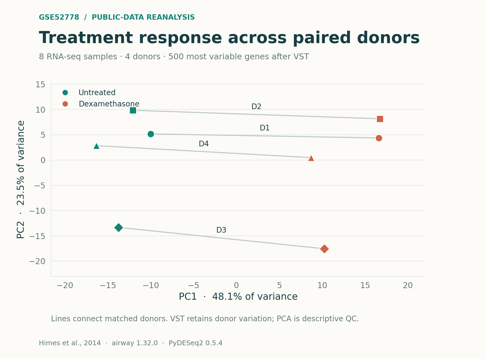
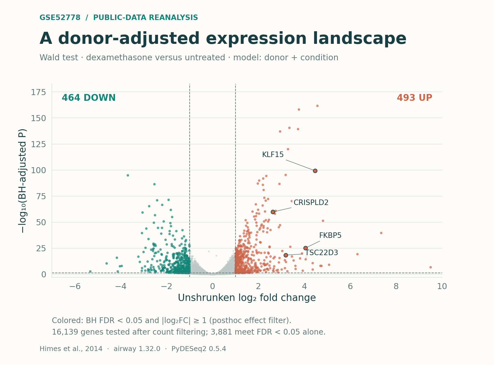
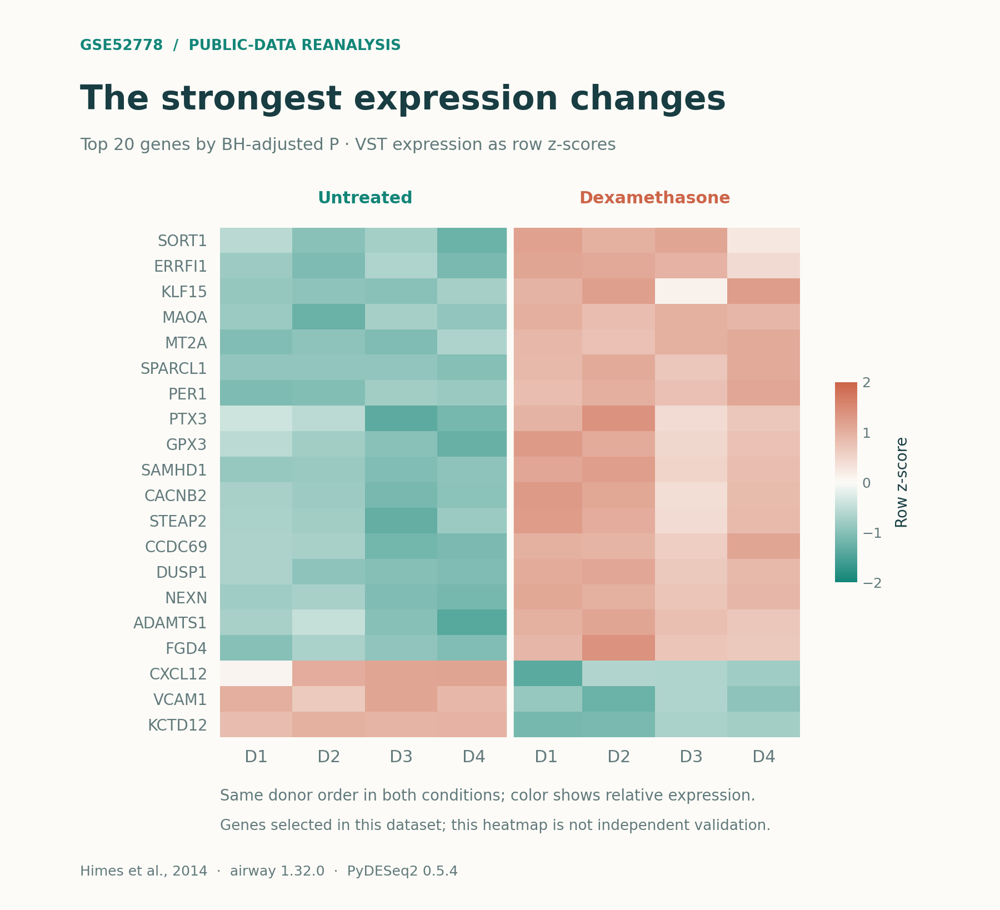
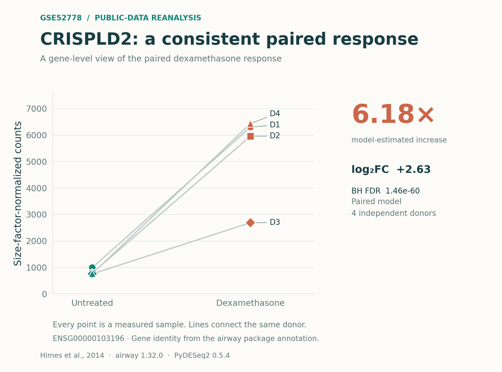

# GSE52778: a paired RNA-seq reanalysis

An executed public-data case study prepared for Maryam Mehrabani's bioinformatics
portfolio. The original experiments are **Himes et al. (2014)**, not a new cohort
generated by the portfolio owner. Figures and results here come from a fresh
**PyDESeq2 0.5.4** reanalysis of the official **airway 1.32.0** raw count matrix.

## Explore the analysis

[Analysis code](scripts/analyze.py) · [Plotting code](scripts/plot_results.py) · [R counterpart](scripts/reanalyze_in_R.R) · [Full results](results/differential_expression.tsv.gz) · [راهنمای فارسی](GUIDE_FA.md)

## Figure gallery

| Sample structure | Differential expression |
|---|---|
|  |  |
| Design-informed VST, top 500 variable genes; donor variation retained. | Positive log2FC indicates higher expression after dexamethasone. |

| Expression patterns | Paired gene response |
|---|---|
|  |  |
| Row-standardized expression; genes selected from this same dataset. | Every donor pair is shown; this is a previously reported responsive gene. |

Open any image for the full-resolution figure. Vector SVG files and detailed
[captions](figures/captions.json) are also included. These plots are descriptive
views of this public-data reanalysis, not independent validation.

## Study and source

Four human airway smooth-muscle donor cell lines were profiled untreated and after
1 µM dexamethasone for 18 h. The eight samples selected by `airway` have no albuterol
treatment. The full GEO study also contains other treatment arms, which are not
included here.

| Donor | Figure label | Untreated run | Dexamethasone run |
|---|---|---|---|
| N052611 | D1 | SRR1039512 | SRR1039513 |
| N061011 | D2 | SRR1039520 | SRR1039521 |
| N080611 | D3 | SRR1039516 | SRR1039517 |
| N61311 | D4 | SRR1039508 | SRR1039509 |

Counts are the integer `airway` assay, **not** GEO FPKM values or the alternative
Salmon `gse` object. The package documents STAR alignment to GRCh37 and gene
counting with `summarizeOverlaps` (Union mode). This work starts from those
precomputed counts; FASTQ files were not realigned. Gene names come from the
package's Ensembl 75 annotation. Current annotation revisions were not substituted.

## Executed methods

- 63,677 input gene features; retain genes with at least 10 counts in at least
  four samples (16,139 retained).
- Median-of-ratios size factors and a negative-binomial model with
  `~ donor + condition`. The design has rank five and three residual degrees of freedom.
- Explicit contrast: `dexamethasone - untreated`; positive log2FC means higher
  expression after dexamethasone.
- Two-sided Wald test of log2FC = 0; BH adjustment with independent filtering
  requested at alpha 0.05. For these inputs, all retained genes receive adjusted P.
- Cook's filtering enabled; automatic count replacement disabled. No LFC shrinkage.
- VST uses the design (`use_design=True`), without subtracting donor effects.
  PCA uses the 500 most variable retained genes. Plots are descriptive QC.
- The volcano colors also apply `|unshrunken log2FC| >= 1`, a **posthoc descriptive
  effect filter**, not an effect-threshold hypothesis test.

## Results from this run

| Quantity | Value |
|---|---:|
| Samples / independent donor pairs | 8 / 4 |
| Genes passing count prefilter | 16,139 |
| Genes with BH FDR < 0.05 | 3,881 |
| Genes also meeting the descriptive effect cutoff | 957 |
| Up / down after both filters | 493 / 464 |
| PCA variance, PC1 / PC2 | 48.11% / 23.53% |
| CRISPLD2 log2FC | +2.6271 |
| CRISPLD2 model-estimated fold change | 6.178 |
| CRISPLD2 BH-adjusted P | 1.4591 × 10^-60 |

CRISPLD2 is mapped to `ENSG00000103196` in the supplied annotation and increases
in all four donor pairs after size-factor normalization. It was already reported
in the original study; this is not a claim of a new biomarker discovery.

Four paired donors give limited information about population variability.
PyDESeq2 warns about dispersion-prior estimation at low residual degrees of
freedom (the package's warning is triggered at df ≤ 3). All 16,139 LFC fits
converged. Some dispersion optimizations used the package's grid-search fallback:
111 gene-wise fits and 7 MAP fits. Complete diagnostics and warnings are retained.
These results do not establish clinical utility, causal mechanism or independent
replication. The expression heatmap selects genes from the same dataset and does
not constitute external validation.

The distributed outputs passed 44 numerical and file-integrity checks, including
an independent BH recalculation (maximum absolute difference: 0), sample pairing,
model rank, normalized-count reconstruction, PCA reconstruction, heatmap values,
CRISPLD2 measurements, source checksums and figure-file parsing. All four final
PNG figures were visually reviewed. This verifies the stated calculations and
artifacts; it does not replace study-level or clinical validation.

## Reproduce the executed Python analysis

Python 3.12 was used. From the project root:

```sh
python -m venv .venv
source .venv/bin/activate
python -m pip install -r requirements.txt
python scripts/analyze.py
python scripts/plot_results.py
python scripts/validate_results.py
```

On Windows, activate with `.venv\Scripts\activate` instead. The package includes
the exact exported counts, metadata, annotation, results and plot inputs.
`scripts/extract_airway.py` can redownload the official package and repeat the
verified extraction; its archive SHA-256 is fixed and checked. The full source
archive and large R object are excluded from the compact ZIP because the extracted
inputs and verified download route are included.

`results/summary.json` records versions and analysis settings. Input checksums,
the design matrix, execution log, fit diagnostics and all-gene removal status are
also included. Requirements pin the execution environment's main packages; these
are the recorded versions, not a claim that every platform has been tested.

## Native R counterpart

For the requested R portfolio example, `scripts/reanalyze_in_R.R` reads the same
real counts and sample metadata, applies the same paired design and thresholds,
and writes a separate `results_R` directory. Install R and DESeq2, then run:

```r
if (!requireNamespace("BiocManager", quietly = TRUE)) install.packages("BiocManager")
BiocManager::install("DESeq2")
```

```sh
Rscript scripts/reanalyze_in_R.R
```

**The R script was not executed here because R is unavailable.** The downloadable
figures and numerical results were produced by Python/PyDESeq2. Native DESeq2 and
PyDESeq2 can differ numerically; compare their recorded environments and results
before claiming native-R reproduction. No results are relabeled as R outputs.

## Figures and files

- `figures/gse52778_pca.svg` and `.png`: all samples, donor pair connections.
- `figures/gse52778_volcano.svg` and `.png`: genome-wide differential expression.
- `figures/gse52778_heatmap.svg` and `.png`: twenty smallest BH-adjusted P-values.
- `figures/gse52778_crispld2.svg` and `.png`: all paired CRISPLD2 measurements.
- `figures/captions.json`: full captions and donor-label mapping.
- `results/differential_expression.tsv.gz`: retained genes and inference.
- `results/all_input_genes.tsv.gz`: every original feature, including removals.
- `results/normalized_counts.tsv.gz`, `vst.tsv.gz`: actual plot inputs.
- `results/fit_diagnostics.tsv.gz`, `warnings.txt`, `execution.log`: model checks.
- `results/validation.json`: executed numerical and file-integrity checks.

No PDF is included. The figures are vector SVG and high-resolution PNG.

## Sources and credit

1. Himes BE et al. RNA-Seq Transcriptome Profiling Identifies CRISPLD2 as a
   Glucocorticoid Responsive Gene that Modulates Cytokine Function in Airway Smooth
   Muscle Cells. *PLoS One* (2014), 9:e99625.
   <https://doi.org/10.1371/journal.pone.0099625>
2. GEO accession GSE52778: <https://www.ncbi.nlm.nih.gov/geo/query/acc.cgi?acc=GSE52778>
3. Michael Love, `airway` 1.32.0: <https://bioconductor.org/packages/airway/>
   and [data construction vignette](https://bioconductor.org/packages/release/data/experiment/vignettes/airway/inst/doc/airway.html).
4. Love MI, Huber W, Anders S. *Genome Biology* (2014), 15:550.
   <https://doi.org/10.1186/s13059-014-0550-8>
5. PyDESeq2 documentation:
   <https://pydeseq2.readthedocs.io/en/stable/auto_examples/plot_step_by_step.html>

The airway package declares the LGPL license; its original metadata are preserved
in `source/DESCRIPTION`. Third-party packages retain their licenses. The new
analysis and plotting scripts were prepared with AI assistance for inspection and
reuse; the original experimental authors retain full study credit.
